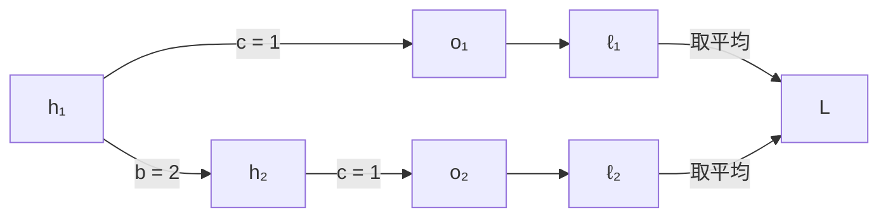

# 8.7 通过时间反向传播：公式推导与影响

[返回思考笔记](Note.md)

以下符号与公式推导为助手补充。

## 8.7.1 循环神经网络的梯度分析

### 符号约定

- $T$：序列长度，也就是思考笔记中的 $n$；$t=1,\ldots,T$ 表示时间步。
- $\mathbf{x}_t$、$\mathbf{h}_t$、$\mathbf{o}_t$、$\mathbf{y}_t$：第 $t$ 步的输入、隐状态、输出和真实标签。
- $\mathbf{w}_h$：隐状态更新所用的共享参数，包含输入权重、循环权重和偏置；$\mathbf{w}_o$：输出层的共享参数。
- $\ell_t=\ell(\mathbf{o}_t,\mathbf{y}_t)$：第 $t$ 步的损失；$L$：整个序列的平均损失。

为明确矩阵乘法的顺序，下面将状态、输出和参数都视为列向量，矩阵参数先展平。$\partial\mathbf{a}/\partial\mathbf{b}$ 表示雅可比矩阵，其第 $(i,j)$ 项为 $\partial a_i/\partial b_j$；标量损失的梯度 $\nabla$ 也写成列向量。初始状态 $\mathbf{h}_0$ 固定，不依赖这些参数。

### 前向传播

每个时间步的隐状态和输出：

$$
\mathbf{h}_t=f(\mathbf{x}_t,\mathbf{h}_{t-1},\mathbf{w}_h),
\qquad
\mathbf{o}_t=g(\mathbf{h}_t,\mathbf{w}_o).
$$

$$
L=\frac{1}{T}\sum_{t=1}^{T}\ell_t
=\frac{1}{T}\sum_{t=1}^{T}\ell(\mathbf{o}_t,\mathbf{y}_t).
$$

### 反向传播

但是反向传播，需要求的是损失对共享参数的梯度 $\nabla_{\mathbf{w}_h}L$，而不是 $L/\mathbf{w}_h$。

每一步的损失都依赖同一组参数，因此要将各步的贡献相加。沿着 $\mathbf{w}_h\to\mathbf{h}_t\to\mathbf{o}_t\to\ell_t$ 使用链式法则：

$$
\nabla_{\mathbf{w}_h}L
=\frac{1}{T}\sum_{t=1}^{T}
\left(\frac{\partial\mathbf{h}_t}{\partial\mathbf{w}_h}\right)^{\!\top}
\left(\frac{\partial\mathbf{o}_t}{\partial\mathbf{h}_t}\right)^{\!\top}
\nabla_{\mathbf{o}_t}\ell_t.
$$

难点在于 $\mathbf{w}_h$ 既直接参与当前状态的计算，也通过 $\mathbf{h}_{t-1}$ 间接影响当前状态。记

$$
D_t=\frac{\partial\mathbf{h}_t}{\partial\mathbf{w}_h},
\qquad
A_t=\frac{\partial f(\mathbf{x}_t,\mathbf{h}_{t-1},\mathbf{w}_h)}{\partial\mathbf{h}_{t-1}},
\qquad
B_t=\frac{\partial f(\mathbf{x}_t,\mathbf{h}_{t-1},\mathbf{w}_h)}{\partial\mathbf{w}_h}.
$$

其中 $A_t$ 和 $B_t$ 都是当前一步的局部偏导；计算 $B_t$ 时将 $\mathbf{h}_{t-1}$ 视为常量，而 $D_t$ 包含所有历史路径的影响。若隐状态维度为 $m$、隐状态更新参数总数为 $p$，则 $A_t\in\mathbb{R}^{m\times m}$，$B_t,D_t\in\mathbb{R}^{m\times p}$。

再次使用链式法则，得到递推式：

$$
D_t=B_t+A_tD_{t-1},\qquad D_0=0.
$$

逐步代入就能看到这个链怎样变长：

$$
\begin{aligned}
D_1&=B_1,\\
D_2&=B_2+A_2B_1,\\
D_3&=B_3+A_3B_2+A_3A_2B_1,\\
D_t&=\sum_{i=1}^{t}\left(A_tA_{t-1}\cdots A_{i+1}\right)B_i.
\end{aligned}
$$

当 $i=t$ 时，括号中没有因子，约定为空乘积 $I_m$，对应当前步的直接影响 $B_t$。当 $i<t$ 时，$B_i$ 表示参数在第 $i$ 步的直接影响，左侧的雅可比矩阵连乘表示这个影响如何沿隐状态传播到第 $t$ 步；矩阵顺序不能交换。

将这个展开式代回损失梯度：

$$
\nabla_{\mathbf{w}_h}L
=\frac{1}{T}\sum_{t=1}^{T}\sum_{i=1}^{t}
B_i^{\top}\left(A_tA_{t-1}\cdots A_{i+1}\right)^{\!\top}
\left(\frac{\partial\mathbf{o}_t}{\partial\mathbf{h}_t}\right)^{\!\top}
\nabla_{\mathbf{o}_t}\ell_t.
$$

输出层参数不参与隐状态递推，所以它的梯度可以直接按时间步相加：

$$
\nabla_{\mathbf{w}_o}L
=\frac{1}{T}\sum_{t=1}^{T}
\left(\frac{\partial g(\mathbf{h}_t,\mathbf{w}_o)}{\partial\mathbf{w}_o}\right)^{\!\top}
\nabla_{\mathbf{o}_t}\ell_t.
$$

## 8.7.2 通过时间反向传播的细节

这一节把参数对状态的抽象影响，落实为隐状态梯度和各组权重梯度的计算。下面先算一个两步标量例子，再写出矩阵形式。初始状态固定，所有时间步共享参数。

### 两步标量例子：前向计算

设

$$
h_t=ax_t+bh_{t-1},\qquad o_t=ch_t.
$$

其中 $a$ 负责输入到隐状态的变换，$b$ 负责状态之间的传播，$c$ 负责隐状态到输出的变换。这三个参数在两个时间步中共享。

取 $a=1$、$b=2$、$c=1$、$x_1=x_2=1$、$h_0=0$，得到：

$$
\begin{aligned}
h_1&=ax_1+bh_0=1,\\
h_2&=ax_2+bh_1=3,\\
o_1&=ch_1=1,\qquad o_2=ch_2=3.
\end{aligned}
$$

假设标签都是 $0$，每步采用平方损失，并对两个时间步取平均：

$$
\ell_t=\frac12o_t^2,\qquad
L=\frac{\ell_1+\ell_2}{2}
=\frac{o_1^2+o_2^2}{4}=2.5.
$$

只画出隐状态到损失的依赖路径：

### 输出梯度与隐状态梯度

先求损失对每个输出的导数：

$$
e_1=\frac{\partial L}{\partial o_1}=\frac{o_1}{2}=0.5,
\qquad
e_2=\frac{\partial L}{\partial o_2}=\frac{o_2}{2}=1.5.
$$

这里的 $1/2$ 来自时间步损失的平均。$e_t$ 表示输出增加一个很小的量时，总损失的局部变化率。

记 $\delta_t=\partial L/\partial h_t$。最后一步只有 $h_2\to o_2\to L$ 这一条路径：

$$
\delta_2
=\frac{\partial L}{\partial o_2}\frac{\partial o_2}{\partial h_2}
=e_2c=1.5.
$$

$h_1$ 有两条通往损失的路径，需要相加：

$$
\begin{aligned}
\delta_1
&=\frac{\partial L}{\partial o_1}\frac{\partial o_1}{\partial h_1}
+\frac{\partial L}{\partial h_2}\frac{\partial h_2}{\partial h_1}\\
&=e_1c+\delta_2b\\
&=0.5\times1+1.5\times2=3.5.
\end{aligned}
$$

第一项是影响当前输出的贡献，第二项是通过下一步状态影响后续损失的贡献。$\delta_2$ 已经汇总了从 $h_2$ 往后的影响，计算 $\delta_1$ 时可以直接复用。

例如，若在计算图中让 $h_1$ 增加一个微小量 $\varepsilon$，则 $o_1$ 增加 $\varepsilon$，$o_2$ 增加 $2\varepsilon$。损失的一阶变化为 $0.5\varepsilon+1.5\times2\varepsilon=3.5\varepsilon$，对应 $\delta_1=3.5$。

### 共享参数的梯度怎样相加

同一个 $c$ 在两个时间步分别参与 $o_1=ch_1$ 和 $o_2=ch_2$，因此：

$$
\frac{\partial L}{\partial c}
=e_1h_1+e_2h_2
=0.5\times1+1.5\times3=5.
$$

同一个 $a$ 在两个时间步直接参与隐状态计算，本步的局部导数为 $x_t$：

$$
\frac{\partial L}{\partial a}
=\delta_1x_1+\delta_2x_2
=3.5\times1+1.5\times1=5.
$$

这里对本步运算求局部偏导时，将上一步状态视为常量；通过历史状态产生的影响已经由隐状态梯度汇总，不能再重复加入。

$b$ 在每一步乘的是上一步隐状态，因此：

$$
\frac{\partial L}{\partial b}
=\delta_1h_0+\delta_2h_1
=3.5\times0+1.5\times1=1.5.
$$

第一步的贡献为零，是因为本例中 $h_0=0$。三组参数的计算都有相同结构：收到的梯度乘上本步的输入，再将各时间步的贡献相加。

### 矩阵模型与形状

教材采用无偏置、恒等激活函数的简化模型。输入维度为 $d$，隐状态维度为 $m$，输出维度为 $q$，各量均按列向量写：

$$
\begin{aligned}
\mathbf h_t&=\mathbf W_{hx}\mathbf x_t+\mathbf W_{hh}\mathbf h_{t-1},\\
\mathbf o_t&=\mathbf W_{qh}\mathbf h_t,\\
L&=\frac1T\sum_{t=1}^{T}\ell(\mathbf o_t,\mathbf y_t).
\end{aligned}
$$

- $\mathbf x_t\in\mathbb R^{d}$，$\mathbf h_t\in\mathbb R^{m}$，$\mathbf o_t\in\mathbb R^{q}$。
- $\mathbf W_{hx}\in\mathbb R^{m\times d}$：输入到隐状态。
- $\mathbf W_{hh}\in\mathbb R^{m\times m}$：上一步隐状态到当前隐状态。
- $\mathbf W_{qh}\in\mathbb R^{q\times m}$：隐状态到输出。

输出梯度为：

$$
\mathbf e_t=\nabla_{\mathbf o_t}L
=\frac1T\nabla_{\mathbf o_t}\ell(\mathbf o_t,\mathbf y_t)
\in\mathbb R^q.
$$

$\mathbf e_t$ 已经包含平均损失的 $1/T$，后面的权重梯度求和时不用再除以 $T$。

### 转置与外积从哪里来

先看单个线性变换 $\mathbf o=\mathbf W\mathbf h$，其中 $\mathbf W\in\mathbb R^{q\times m}$。按分量写，第 $i$ 个输出为：

$$
o_i=\sum_{j=1}^{m}W_{ij}h_j.
$$

记 $e_i=\partial L/\partial o_i$。同一个 $h_j$ 会影响多个输出，因此：

$$
\frac{\partial L}{\partial h_j}
=\sum_{i=1}^{q}\frac{\partial L}{\partial o_i}
\frac{\partial o_i}{\partial h_j}
=\sum_{i=1}^{q}e_iW_{ij}.
$$

将所有 $j$ 对应的结果写成列向量，得到：

$$
\nabla_{\mathbf h}L=\mathbf W^{\top}\mathbf e,
\qquad
(m\times q)(q\times1)=m\times1.
$$

转置来自分量求和的结构，也使结果的形状与输入状态一致。

再看单个权重 $W_{ij}$：

$$
\frac{\partial L}{\partial W_{ij}}
=\frac{\partial L}{\partial o_i}\frac{\partial o_i}{\partial W_{ij}}
=e_i h_j.
$$

把所有 $(i,j)$ 项排成矩阵，就得到外积：

$$
\nabla_{\mathbf W}L=\mathbf e\mathbf h^{\top},
\qquad
(q\times1)(1\times m)=q\times m.
$$

### 隐状态梯度的反向递推

记 $\boldsymbol\delta_t=\nabla_{\mathbf h_t}L\in\mathbb R^m$。最后一步没有后续状态：

$$
\boldsymbol\delta_T=\mathbf W_{qh}^{\top}\mathbf e_T.
$$

对于 $t<T$，隐状态通过当前输出和下一步状态两条分支影响损失：

$$
\boldsymbol\delta_t
=\mathbf W_{qh}^{\top}\mathbf e_t
+\mathbf W_{hh}^{\top}\boldsymbol\delta_{t+1}.
$$

第一项来自当前输出，第二项来自所有后续时间步。实际从 $T$ 向 $1$ 计算并保存各步的 $\boldsymbol\delta_t$，避免重复展开同一段链。

### 三组权重的梯度

输出层在每个时间步的局部贡献为 $\mathbf e_t\mathbf h_t^{\top}$；输入权重和循环权重的本步输入分别为 $\mathbf x_t$ 与 $\mathbf h_{t-1}$。将共享参数在各步的贡献相加：

$$
\begin{aligned}
\nabla_{\mathbf W_{qh}}L
&=\sum_{t=1}^{T}\mathbf e_t\mathbf h_t^{\top}
\in\mathbb R^{q\times m},\\
\nabla_{\mathbf W_{hx}}L
&=\sum_{t=1}^{T}\boldsymbol\delta_t\mathbf x_t^{\top}
\in\mathbb R^{m\times d},\\
\nabla_{\mathbf W_{hh}}L
&=\sum_{t=1}^{T}\boldsymbol\delta_t\mathbf h_{t-1}^{\top}
\in\mathbb R^{m\times m}.
\end{aligned}
$$

每个结果的形状都与对应权重一致。本步对权重求的是局部偏导，后续损失的影响由 $\boldsymbol\delta_t$ 提供。

### 与前一节递推式的区别

- $D_t=\partial\mathbf h_t/\partial\mathbf w_h$：追踪参数如何影响当前状态，递推依赖 $D_{t-1}$，形状为 $m\times p$。
- $\boldsymbol\delta_t=\nabla_{\mathbf h_t}L$：汇总当前状态如何影响总损失，递推依赖 $\boldsymbol\delta_{t+1}$，是 $m$ 维列向量。

两种写法都使用链式法则。BPTT 利用后一种组织方式，先反向汇总隐状态梯度，再累积参数梯度；通常不显式构造完整的 $D_t$。

在 PyTorch 中，前向运算建立计算图，调用 `loss.backward()` 后，自动求导会沿图反向计算，并把共享参数各次使用的贡献累加到 `.grad` 中。

## 梯度传播的影响

### 对状态与参数更新的影响

隐状态梯度表示该状态微小变化时总损失的局部变化率。例子中 $\delta_1=3.5$，包含当前步的 $0.5$ 和通过后续状态传来的 $3$，所以第一步状态也会接收第二步损失的反馈。

参数梯度还要结合本步输入。某步的状态梯度较大，并不表示所有权重在这一步的贡献都较大；例如 $h_0=0$ 使本例中循环参数 $b$ 在第一步的直接贡献为零。

对于单个标量参数 $w$，有 $\Delta L\approx(\partial L/\partial w)\Delta w$。梯度下降使用 $\Delta w=-\eta\,\partial L/\partial w$；这是当前位置的一阶近似，步长过大时不能据此保证损失下降。

### 长链、梯度消失与梯度爆炸

在线性、共享循环权重的模型中，将隐状态递推展开：

$$
\boldsymbol\delta_t
=\sum_{k=t}^{T}
\left(\mathbf W_{hh}^{\top}\right)^{k-t}
\mathbf W_{qh}^{\top}\mathbf e_k.
$$

未来第 $k$ 步的损失影响要经过 $k-t$ 次状态传播。标量情形中，这个系数就是 $b^{k-t}$：$b=0.5$ 时远处贡献逐渐缩小，$b=2$ 时可能被迅速放大。

矩阵模型中要看连乘对具体方向的作用，实际非线性模型还包含激活函数的导数，不能只根据某一个权重元素的大小判断。梯度消失使远距离训练信号变弱，梯度爆炸使更新幅度过大并可能造成数值不稳定。

### 计算时间与内存

完整 BPTT 可以计算。常规实现会保存中间结果，先前向计算，再通过反向递推复用结果；不必为展开式中的每条路径都从头计算。

固定网络宽度和批量大小时，一次完整前向、反向的时间通常随 $T$ 线性增长，常规保存中间激活的内存也随 $T$ 增长。长序列的主要问题是需要处理和保存的步骤多，以及梯度连乘过长，不是所有完整 BPTT 都必然不可行。

### 截断与裁剪的影响

- 固定长度截断在片段边界分离计算图，限制单次反向追溯的长度和所需保存的中间结果。整条序列仍然需要被处理。
- `detach()` 保留隐状态数值供下一段使用；对于下一段的求导，边界状态被视为固定输入，跨边界的历史梯度路径被切断。
- 固定截断一般得到完整梯度的有偏近似，减少远距离依赖的训练信号。
- 随机截断配合保留概率的倒数权重，在固定前向计算和适当独立抽样条件下可得到无偏估计，但长路径低概率、高权重会增加方差，实践中未必优于固定截断。
- 梯度裁剪在梯度算出后限制其大小，可以缓解爆炸；它不会恢复被截断的路径，也不能解决梯度消失。

思考笔记中的“少算梯度使结果偏小”对应前面各项都为正的数值例子。一般梯度分量可以为正或负，漏掉贡献会改变估计并产生偏差，不能保证每个分量的数值都变小。

### 使用实际激活函数时

本节矩阵递推使用恒等激活函数。实际使用 $\tanh$ 时，还需要在相应状态更新的链式法则中计入逐元素导数 $1-h_{t,j}^2$；不能直接把线性模型的所有梯度式原样用于非线性模型。

## 参考

- [《动手学深度学习》8.7：通过时间反向传播](https://zh.d2l.ai/chapter_recurrent-neural-networks/bptt.html)
- [PyTorch：Tensor.detach](https://docs.pytorch.org/docs/stable/generated/torch.Tensor.detach.html)
